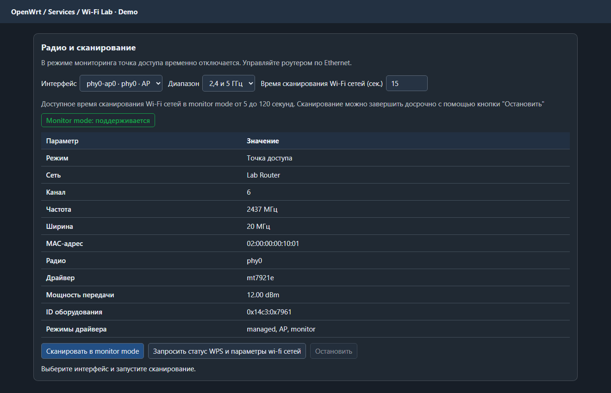
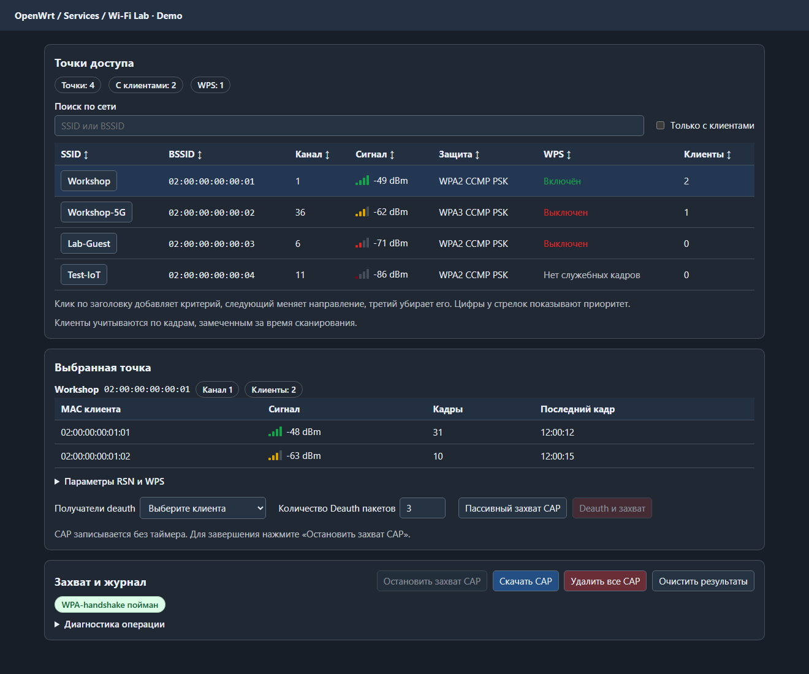
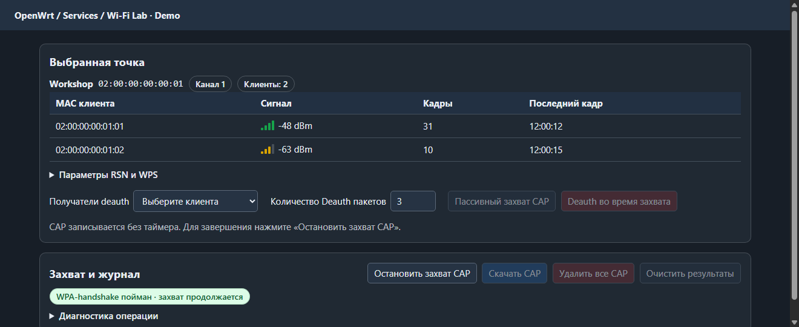

# Wi-Fi Lab для OpenWrt

Пакет LuCI для обследования своих Wi-Fi сетей и проверки WPA-handshake. Целевая версия — OpenWrt 25.12 с LuCI и драйвером, поддерживающим monitor mode. Реализация переключения рассчитана на интерфейсы mac80211, для которых `airmon-ng` создаёт интерфейс с суффиксом `mon`.

## Скриншоты

Интерфейс приложения с демонстрационными данными. Реальные SSID, BSSID и адреса клиентов в кадрах отсутствуют.







## Установка

Скачайте APK и `SHA256SUMS` из **Releases → Latest**. Проверьте файл командой `sha256sum -c SHA256SUMS`. Передайте APK в `/tmp` роутера и выполните от root:

```sh
apk add --allow-untrusted /tmp/luci-app-wifi-lab-0.1.0-r38.apk
```

Пакет локальной сборки, без подписи. Обновите страницу LuCI или войдите снова. Откройте **Сервисы → Wi-Fi Lab**. Для управления используйте Ethernet: `airmon-ng` временно снимает выбранную точку доступа.

## Работа

1. Выберите Wi-Fi интерфейс, диапазон и время. Нажмите **Запросить статус WPS и параметры wi-fi сетей**, чтобы получить сведения `iw` о видимых BSSID, включая RSN, параметры WPS и возможности радио. Отметка WPS показывает наличие соответствующего элемента в принятых кадрах. Она сама по себе не подтверждает, что PIN или PBC сейчас принимаются.
2. Запустите **Сканировать в monitor mode**. По умолчанию сбор длится 15 секунд, допустимый диапазон — 5–120 секунд. Счётчик показывает клиентов, замеченных у BSSID за время скана. Клики по заголовкам задают порядок сортировки.
3. Выберите сеть и запустите **Пассивный захват CAP**. В своей тестовой сети можно отправить deauth конкретному клиенту или всем клиентам выбранного BSSID. Для адресной отправки приложение ждёт появления клиента в захвате и проверяет канал.
4. Раздел **Захват и журнал** показывает результат проверки WPA-handshake во время записи. Здесь же можно остановить захват, скачать CAP или удалить файлы захвата.

Запись CAP работает без таймера и ограничена размером файла. Хранится один последний CAP, который заменяется при следующей операции. Скачайте его перед запуском нового сканирования или захвата. Таблица последнего обзора и данные WPS остаются до очистки или перезагрузки.

## Сборка

В OpenWrt SDK поместите каталог в `package/luci-app-wifi-lab` и выполните `make package/luci-app-wifi-lab/compile V=s`. Для сборки пакета из готовых скриптов можно запустить `sh tools/build-apk.sh` в Linux с apk-tools 3, поддерживающим `mkpkg`. При необходимости укажите путь к сборщику через `APK_TOOL`.

Скрипт `tools/install.sh` принимает путь к локальному APK. Для публикации собранного пакета создайте и отправьте Git-тег версии, затем запустите `sh tools/publish-release.sh OWNER/REPOSITORY ./luci-app-wifi-lab-0.1.0-r38.apk` из корня репозитория с авторизованным GitHub CLI.
